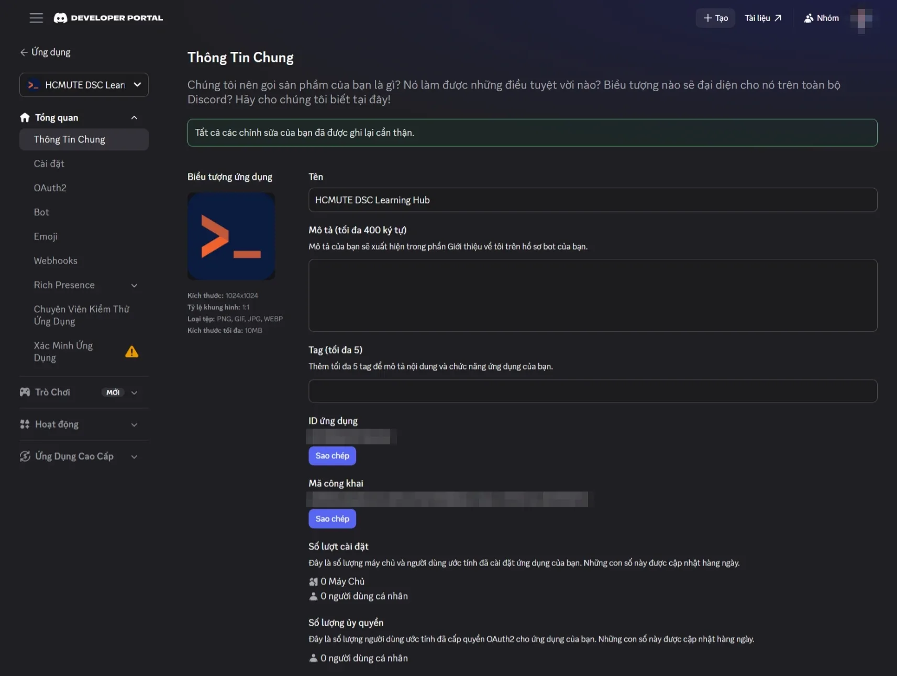

# Webhook, bot và Discord application

Từ chương 2 tới giờ, mọi tin nhắn đều đi qua **webhook**: một URL, gửi `POST` là tin hiện trong kênh. Webhook chỉ làm được một chiều: **gửi tin vào một kênh**. Nó không biết ai đang đọc tin, và không biết người dùng trang web của bạn là ai trên Discord.

Muốn làm nhiều hơn thế thì cần một **Discord application**.

## Ba cách làm việc với Discord

| | Webhook | Bot | OAuth2 (đăng nhập bằng Discord) |
| --- | --- | --- | --- |
| Làm được gì | Gửi, sửa, xóa tin trong **một** kênh | Đọc tin, trả lời lệnh, quản lý server | Hỏi người dùng "bạn là ai trên Discord" |
| Cần application không | Không | Có | Có |
| Bí mật cần giữ | Webhook URL | Bot token | Client Secret |
| Ví dụ | Nhắc lịch hằng tuần (chương 6) | Bot trả lời `/help` | Nút "Kết nối Discord" của Learning Hub |

Application giống một **hồ sơ** của app bạn trên Discord: tên, icon, mô tả. Bot và OAuth2 đều gắn với một application. Một application có thể chỉ dùng OAuth2, không cần bot.

**Chọn cái đơn giản nhất làm được việc.** Chỉ cần gửi thông báo thì webhook là đủ. Chương này dùng OAuth2 vì cần biết id Discord của người dùng, và việc đó webhook không làm được.

## Tạo application

1. Vào [Discord Developer Portal](https://discord.com/developers/applications) và đăng nhập Discord.
2. Bấm **New Application**, đặt tên, đồng ý điều khoản của Discord, rồi bấm **Create**.
3. Bạn vào trang **General Information** (Thông Tin Chung):

Ảnh chụp giao diện tiếng Việt. Nếu Discord của bạn dùng tiếng Anh, tên các mục là: **General Information**, **OAuth2**, **Bot**, **Webhooks**.

Trên trang này:

- **Tên**, **Biểu tượng ứng dụng** và **Mô tả** hiện trên màn hình xin quyền mà người dùng thấy khi đăng nhập. Đặt tên rõ ràng để người dùng biết ai đang xin quyền.
- **ID ứng dụng** (Application ID) cũng chính là **Client ID** ở bài sau.
- **Mã công khai** (Public Key) dùng để kiểm tra request Discord gửi tới bot của bạn. Chương này chưa cần đến nó.

## Công khai hay bí mật

| Thông tin | Công khai? | Vì sao |
| --- | --- | --- |
| Application ID / Client ID | Công khai | Nằm sẵn trong link đăng nhập mà ai cũng thấy |
| Public Key | Công khai | Chỉ dùng để kiểm tra chữ ký, không ký được gì |
| **Client Secret** | **Bí mật** | Ai có nó có thể giả làm app của bạn khi đổi `code` lấy token |
| **Bot token** | **Bí mật** | Ai có nó điều khiển được bot của bạn |

Áp dụng đúng quy tắc của chương 5 cho Client Secret và bot token: để trong `.env` hoặc GitHub Secrets, không commit, không dán vào chat. Ảnh chụp màn hình trong bài này đã che các ID, và bạn cũng nên che khi gửi ảnh cho người khác.

## Ai sở hữu application

Application thuộc về tài khoản Discord đã tạo nó. Nếu tạo cho một CLB hay một nhóm, hãy chuyển nó vào một **Team** (mục **Nhóm** ở góc trên Developer Portal). Như vậy khi người tạo rời nhóm, các thành viên khác vẫn đổi được Client Secret và redirect, không phải tạo lại application từ đầu.
