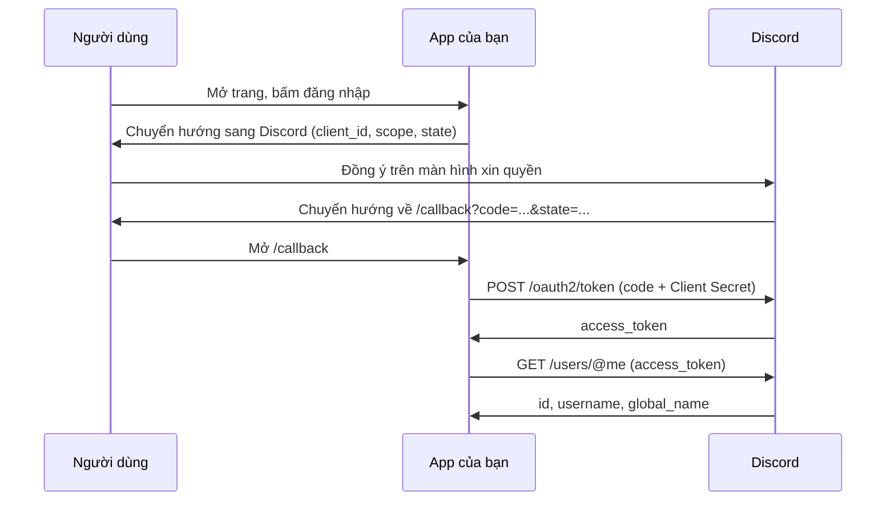
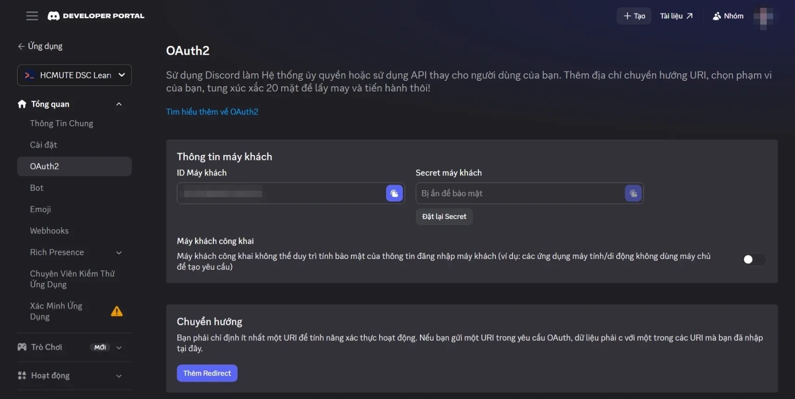
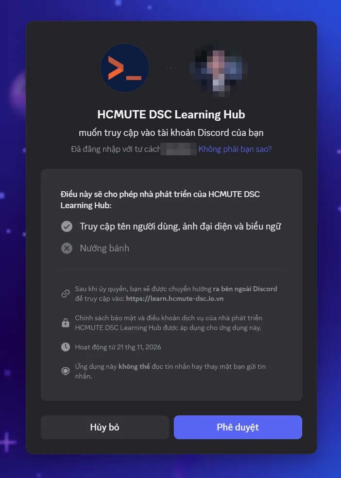

# Đăng nhập bằng Discord với OAuth2

Mục tiêu: một trang web nhỏ trên máy bạn, bấm vào là Discord hỏi "cho phép app này biết bạn là ai không?". Đồng ý xong, trang hiện tên và **id Discord** của bạn. App không bao giờ thấy mật khẩu Discord của người dùng.

Learning Hub dùng đúng cách này cho nút **Kết nối Discord** trong trang Cài đặt.

## Luồng authorization code



Hai điểm then chốt:

- **`code`** đi qua trình duyệt nên ai cũng có thể thấy. Nó chỉ dùng được **một lần**, hết hạn sau vài phút, và phải đi kèm **Client Secret** mới đổi được ra token. Bước đổi này chạy trên máy chủ của bạn, không chạy trên trình duyệt.
- **`access_token`** cho phép đọc thông tin người dùng theo đúng scope đã xin. Giữ nó như một secret. Bài này dùng token xong là bỏ, không lưu lại.

## Bước 1. Khai báo redirect

Vào application đã tạo ở bài trước, mở tab **OAuth2**:



Trong mục **Chuyển hướng** (Redirects), bấm **Thêm Redirect**, nhập rồi bấm **Lưu**:

```
http://localhost:8000/callback
```

Discord chỉ chuyển người dùng về những địa chỉ đã khai báo ở đây, và địa chỉ phải **khớp từng ký tự**. `http://localhost:8000/callback/` (thêm dấu `/` ở cuối) hay `http://127.0.0.1:8000/callback` đều bị coi là địa chỉ khác. Khi đưa app lên mạng thật, thêm một redirect nữa với tên miền thật, ví dụ `https://learn.hcmute-dsc.io.vn/api/v1/me/discord/callback` của Learning Hub.

## Bước 2. Lấy Client ID và Client Secret

Vẫn ở tab **OAuth2**, mục **Thông tin máy khách** (Client information):

- **ID Máy khách** (Client ID): bấm nút chép.
- **Secret máy khách** (Client Secret): bấm **Đặt lại Secret**. Discord chỉ hiện secret **một lần**, nên chép ngay. Lỡ đóng mất thì bấm đặt lại lần nữa (secret cũ hết hiệu lực).
- Để **tắt** công tắc **Máy khách công khai** (Public client). App của bài này có máy chủ riêng nên giữ được secret.

Phần **Công cụ tạo URL OAuth2** ở dưới không cần dùng, vì script sẽ tự tạo link.

## Bước 3. Chỉ xin scope cần thiết

Scope là danh sách quyền app xin. Mỗi scope là một dòng trên màn hình xin quyền, và xin càng nhiều thì người dùng càng ngại đồng ý.

| Scope | Cho app biết | Bài này cần? |
| --- | --- | --- |
| `identify` | id, username, tên hiển thị, avatar | Có |
| `email` | email của tài khoản Discord | Không |
| `guilds` | danh sách server người dùng tham gia | Không |
| `bot` | thêm bot vào server | Không |

Chỉ xin `identify`. Người dùng sẽ thấy màn hình như sau:



Màn hình ghi rõ app **không thể** đọc tin nhắn hay gửi tin thay người dùng. Đó là nhờ chỉ xin `identify`.

## Script

Đặt hai biến môi trường như chương 4 (hoặc để trong `.env` theo chương 5).

Git Bash, macOS, Linux:

```bash
export DISCORD_CLIENT_ID="dán Client ID"
export DISCORD_CLIENT_SECRET="dán Client Secret"
```

PowerShell:

```powershell
$env:DISCORD_CLIENT_ID = "dán Client ID"
$env:DISCORD_CLIENT_SECRET = "dán Client Secret"
```

Tạo file `login.py`. Script chỉ dùng thư viện có sẵn của Python:

```python
import base64
import html
import json
import os
import secrets
import sys
import urllib.error
import urllib.parse
import urllib.request
from http.server import BaseHTTPRequestHandler, HTTPServer

CLIENT_ID = os.environ.get("DISCORD_CLIENT_ID")
CLIENT_SECRET = os.environ.get("DISCORD_CLIENT_SECRET")
if not CLIENT_ID or not CLIENT_SECRET:
    sys.exit("Chưa đặt DISCORD_CLIENT_ID hoặc DISCORD_CLIENT_SECRET")

REDIRECT_URI = "http://localhost:8000/callback"
AUTHORIZE_URL = "https://discord.com/oauth2/authorize"
API = "https://discord.com/api/v10"
USER_AGENT = "dsc-oauth-lesson/1.0"

# Chuỗi ngẫu nhiên, tạo mới mỗi lần chạy. Discord trả lại nguyên văn ở /callback.
STATE = secrets.token_urlsafe(16)


def call_discord(request):
    request.add_header("User-Agent", USER_AGENT)
    with urllib.request.urlopen(request, timeout=10) as response:
        return json.load(response)


def exchange_code(code):
    """Đổi code (dùng một lần, sống vài phút) lấy access token."""
    body = urllib.parse.urlencode({
        "grant_type": "authorization_code",
        "code": code,
        "redirect_uri": REDIRECT_URI,
    }).encode("utf-8")
    basic = base64.b64encode(f"{CLIENT_ID}:{CLIENT_SECRET}".encode()).decode()
    request = urllib.request.Request(
        f"{API}/oauth2/token",
        data=body,
        headers={
            "Authorization": f"Basic {basic}",
            "Content-Type": "application/x-www-form-urlencoded",
        },
        method="POST",
    )
    return call_discord(request)["access_token"]


def get_me(access_token):
    request = urllib.request.Request(
        f"{API}/users/@me",
        headers={"Authorization": f"Bearer {access_token}"},
    )
    return call_discord(request)


class Handler(BaseHTTPRequestHandler):
    def do_GET(self):
        url = urllib.parse.urlparse(self.path)
        query = urllib.parse.parse_qs(url.query)

        if url.path == "/":
            params = urllib.parse.urlencode({
                "client_id": CLIENT_ID,
                "response_type": "code",
                "redirect_uri": REDIRECT_URI,
                "scope": "identify",
                "state": STATE,
            })
            self.send_response(302)
            self.send_header("Location", f"{AUTHORIZE_URL}?{params}")
            self.end_headers()
            return

        if url.path != "/callback":
            self.reply(404, "Không có trang này")
            return
        if "error" in query:  # người dùng bấm Hủy bỏ
            self.reply(400, "Bạn đã hủy đăng nhập")
            return
        if query.get("state") != [STATE]:
            self.reply(400, "state không khớp, bỏ qua request này")
            return

        try:
            token = exchange_code(query["code"][0])
            me = get_me(token)
        except (KeyError, urllib.error.URLError) as error:
            print("Lỗi khi gọi Discord:", error)
            self.reply(502, "Không đăng nhập được, xem terminal")
            return

        name = me.get("global_name") or me["username"]
        print(f"Đã đăng nhập: {name} (id {me['id']})")
        self.reply(200, f"Xin chào {name}! id Discord của bạn là {me['id']}.")

    def reply(self, status, text):
        self.send_response(status)
        self.send_header("Content-Type", "text/html; charset=utf-8")
        self.end_headers()
        self.wfile.write(f"<p>{html.escape(text)}</p>".encode("utf-8"))


if __name__ == "__main__":
    print("Mở http://localhost:8000 để đăng nhập bằng Discord")
    HTTPServer(("localhost", 8000), Handler).serve_forever()
```

Chạy `python login.py`, mở `http://localhost:8000` trong trình duyệt, bấm **Phê duyệt** (Authorize). Trang hiện `Xin chào <tên của bạn>! id Discord của bạn là ...`. Bấm `Ctrl+C` trong terminal để tắt.

## Đọc hiểu từng phần

- **`/`** không hiện gì, chỉ chuyển hướng (`302`) sang trang xin quyền của Discord, kèm `client_id`, `redirect_uri`, `scope=identify` và `state`.
- **`state`** chặn kiểu tấn công "dụ người dùng mở một link `/callback` do kẻ xấu tạo sẵn" (CSRF). App chỉ chấp nhận `/callback` mang đúng chuỗi ngẫu nhiên mà chính nó đã gửi đi. Script tạo `state` mới mỗi lần chạy. Một web app thật sẽ lưu `state` theo từng người dùng, thường trong cookie.
- **`error`** xuất hiện khi người dùng bấm **Hủy bỏ** (`error=access_denied`).
- **`exchange_code`** gửi `code` kèm Client ID và Client Secret theo kiểu `Basic` auth, body ở dạng form (`application/x-www-form-urlencoded`), không phải JSON. `redirect_uri` ở đây phải giống hệt lúc chuyển hướng.
- **`get_me`** gọi `GET /users/@me` với header `Authorization: Bearer <token>`. Kết quả có `id` (số dạng chuỗi, không bao giờ đổi), `username` và `global_name` (tên hiển thị, có thể trống).
- **`html.escape`**: tên Discord do người dùng tự đặt. Không escape thì một cái tên như `<script>...` sẽ chạy được trong trang của bạn.
- **`User-Agent`**: giống chương 4, Discord có thể chặn tên mặc định của `urllib`.

## Lỗi thường gặp

| Thấy gì | Nguyên nhân |
| --- | --- |
| Trang Discord báo `Invalid OAuth2 redirect_uri` | `REDIRECT_URI` trong script không khớp từng ký tự với redirect đã khai báo |
| Terminal: `HTTP Error 401` khi đổi code | Client ID hoặc Client Secret sai, hoặc secret vừa bị đặt lại |
| Terminal: `HTTP Error 400` khi đổi code | `code` đã dùng rồi hoặc đã hết hạn (ví dụ tải lại trang `/callback`). Bắt đầu lại từ `/` |
| `state không khớp` | Bạn mở lại một link `/callback` cũ sau khi chạy lại script. Bắt đầu lại từ `/` |
| `Address already in use` | Cổng 8000 đang bị chương trình khác dùng. Tắt chương trình đó, hoặc đổi cổng ở cả script lẫn redirect |
